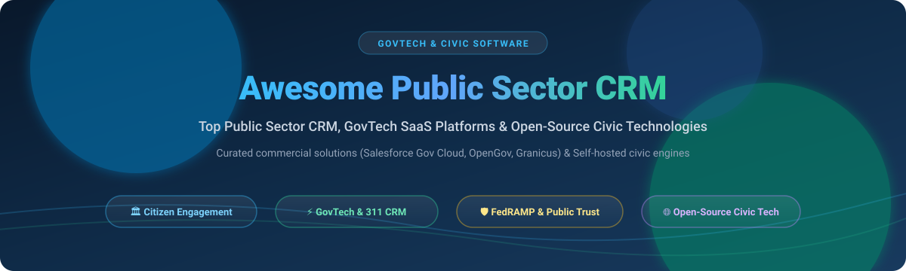

  

# 🏛️ Awesome Public Sector CRM 🌟

  
  
  
  
  

## 🌐 Curated Public Sector CRM, GovTech & Civic Engagement Solutions

> **A Comprehensive, SEO-Optimized Guide to Leading Commercial Government SaaS Platforms and Self-Hosted Open-Source Civic Technologies.**  
> *Targeted at government CIOs, public administrators, municipal IT teams, civic tech developers, and digital transformation leaders.*  
> 📅 **Last updated: October 2026**

---

## 🔍 Overview & SEO Keywords

Public sector organizations—including federal agencies, state governments, municipal councils, public health authorities, and civic bodies—require specialized **Customer Relationship Management (CRM)** and **Citizen Relationship Management** systems. Unlike conventional B2B or B2C solutions, public sector software demands strict regulatory compliance (**FedRAMP High/Moderate, StateRAMP, CJIS, SOC 2 Type II, GDPR, ADA Section 508**), specialized citizen request management (**311 intake, FOIA / public records requests**), digital permitting, licensing, and secure omnichannel citizen communications.

This curated list breaks down market-leading commercial **GovTech SaaS platforms** alongside top **open-source civic technologies** to help public agencies modernize constituent services, avoid vendor lock-in, and maximize public value.

**Primary Keywords & Tags:** `Public Sector CRM`, `GovTech`, `Civic Tech`, `Citizen Relationship Management`, `Government Cloud`, `Municipal Software`, `Constituent Engagement`, `311 Request Management`, `Public Records FOIA`, `Government Open Source`, `FedRAMP CRM`, `Digital Permitting & Licensing`.

---

## 📑 Table of Contents

- [☁️ SaaS / Commercial Government CRM Platforms](#️-saas--commercial-government-crm-platforms)
- [💻 Open-Source Civic Tech & Public Sector Repositories](#-open-source-civic-tech--public-sector-repositories)
  - [⚡ Top Repositories (Sorted by Star Count)](#-top-repositories-sorted-by-star-count)
  - [🏛️ Categorized Open-Source Civic Solutions](#️-categorized-open-source-civic-solutions)
- [📈 Star History](#-star-history)
- [💖 Support & Sponsorship](#-support--sponsorship)
- [🤝 How to Contribute](#-how-to-contribute)
- [⚠️ Compliance & Security Disclaimer](#️-compliance--security-disclaimer)

---

## ☁️ SaaS / Commercial Government CRM Platforms

The global GovTech and public sector software market is valued at approximately **$59.3 billion in 2026** (with the dedicated Government CRM & citizen engagement segment accounting for **$11.8 billion** and expanding at an 11.2% CAGR). The sector is **moderately fragmented**: mega-cap cloud providers (such as Salesforce) dominate broad horizontal agency workflows, while specialized GovTech leaders (Tyler Technologies, OpenGov, Granicus, CivicPlus) command deep moats across specialized municipal niches such as 311 ticketing, agenda management, ERP budgeting, and public records administration.

The following commercial public sector platforms are sorted by **Company Size (Valuation / Enterprise Scale) in descending order**:

| Product | Government Focus & Capabilities | Company Size (Valuation / Revenue) | Starting Tier Pricing | Free Tier / Trial Limits |
| :--- | :--- | :--- | :--- | :--- |
| **[Salesforce Government Cloud](https://www.salesforce.com/solutions/public-sector/)** | FedRAMP High/IL4/IL5 authorized public sector CRM for omnichannel constituent engagement, case routing, grants management, and licensing. | **$187B Market Cap** ($41.5B FY26 Revenue) | **$150/user/month** (Public Sector Solutions Enterprise Edition) | **30-day free trial** (Full-featured sandbox org with government demo schemas) |
| **[Carahsoft Solutions](https://www.carahsoft.com/)** | Master government aggregator delivering turnkey CRM architectures (Salesforce, ServiceNow, Microsoft Cloud) across federal and state contracts. | **$16B+ Annual Public Sector Revenue** | **$125/user/month** (Baseline bundled GSA schedule entry per seat) | **30-day proof-of-concept (POC) sandbox trial** (Available via agency contract requests) |
| **[Tyler Technologies](https://www.tylertech.com/)** | Comprehensive municipal ecosystem encompassing civic CRM, Enterprise Permitting & Licensing (EnerGov), municipal courts, and citizen portals. | **$19.5B Market Cap** ($2.2B Annual Revenue) | **$3,500/year** (Civic Services entry bundle for small municipalities) | **14-day guided product sandbox** (Includes simulated municipal demo datasets) |
| **[Granicus (GovDelivery / Experience Cloud)](https://granicus.com/)** | Unified citizen engagement engine powering multichannel communications, digital 311 service requests, meeting agendas, and short-term rental compliance. | **$2.5B Valuation** ($300M+ ARR, Vista Equity Partners) | **$2,400/year** (GovDelivery Communications Cloud base tier) | **14-day government evaluation sandbox** (Up to 1,000 test subscriber sends) |
| **[OpenGov](https://opengov.com/)** | Cloud-native government operating system unifying citizen budgeting, community development, asset management, and digital permitting. | **$1.8B Valuation** (Acquired by Cox Enterprises) | **$5,000/year** (Citizen Services & Permitting entry municipal bundle) | **14-day scheduled interactive demo environment** (Simulated council/agency setup) |
| **[CivicPlus](https://www.civicplus.com/)** | Local government civic experience platform featuring integrated SeeClickFix 311 CRM, municipal websites, recreation management, and mass notifications. | **$1.2B Valuation** ($180M+ ARR) | **$1,800/year** (SeeClickFix 311 municipal starter bundle) | **14-day free trial** (Full SeeClickFix municipal portal testing limit) |
| **[Accela](https://www.accela.com/)** | Enterprise civic application engine specializing in land management, building permits, environmental health, and cannabis licensing. | **$850M Valuation** (Francisco Partners) | **$12,000/year** (Civic Applications Starter Edition per agency department) | **30-day agency sandbox test environment** (Limited to 5 department test users) |
| **[NIC Inc. (Tyler Technologies)](https://www.egov.com/)** | Digital government pioneer operating official state portals, citizen ID services, DMV integrations, and regulatory licensing workflows. | **$2.3B Acquisition Valuation** | **$0 upfront / Transaction-based fee** ($1.00 - $2.50 or 2.25% processing fee per transaction) | **30-day state portal sandbox integration trial** (Full sandbox test credentials) |
| **[GovQA (Granicus)](https://govqa.com/)** | The premier public records request (FOIA) CRM platform automating redaction, cross-department intake, subpoena tracking, and exemption workflows. | **$150M Division Scale** (Granicus Public Records Suite) | **$3,600/year** (GovQA FOIA Starter Suite for single agency/city) | **14-day FOIA request intake test environment** (Up to 25 sample public filings) |
| **[PayGov](https://www.paygov.us/)** | Public sector payment and collections CRM integrating court fee payments, utility bills, parking citations, and tax collection. | **$85M Enterprise Scale** | **$0 setup / Convenience fee structure** (Direct fee of 2.5% or $1.50 minimum per payment) | **30-day payment gateway merchant testing sandbox** (Virtual testing merchant account) |

---

## 💻 Open-Source Civic Tech & Public Sector Repositories

For government agencies pursuing digital sovereignty, transparent codebases, or custom self-hosted citizen portals, these open-source repositories provide production-ready solutions.

### ⚡ Top Repositories (Sorted by Star Count)

| Repository | Project Focus | Stars Badge (Link to Stargazers) | License | Primary Tech Stack |
| :--- | :--- | :--- | :--- | :--- |
| **[twentyhq/twenty](https://github.com/twentyhq/twenty)** | Modern open-source CRM alternative to Salesforce; ideal for government agencies wanting full data sovereignty and customizable schema. |  | AGPL-3.0 | TypeScript, React, NestJS, PostgreSQL |
| **[frappe/erpnext](https://github.com/frappe/erpnext)** | Full-featured ERP and public sector administrative CRM covering budgeting, constituent records, procurement, and asset management. |  | GPL-3.0 | Python, Frappe, MariaDB, Redis |
| **[SuiteCRM/SuiteCRM](https://github.com/SuiteCRM/SuiteCRM)** | Enterprise-grade open-source CRM frequently deployed by regional governments and municipalities for constituent relationship workflows. |  | AGPL-3.0 | PHP, Symfony, MySQL, MariaDB |
| **[espocrm/espocrm](https://github.com/espocrm/espocrm)** | Lightweight, highly configurable web CRM with robust REST APIs, role-based access control, and citizen case workflow automation. |  | AGPL-3.0 | PHP, JavaScript, MySQL |
| **[decidim/decidim](https://github.com/decidim/decidim)** | Leading participatory democracy and citizen engagement platform powering municipal voting, citizen consultations, and participatory budgets. |  | AGPL-3.0 | Ruby on Rails, PostgreSQL |
| **[consuldemocracy/consuldemocracy](https://github.com/consuldemocracy/consuldemocracy)** | Open government platform used by over 130 city councils worldwide for citizen debates, budget allocations, and public proposals. |  | AGPL-3.0 | Ruby on Rails, PostgreSQL |
| **[alphagov/govuk-frontend](https://github.com/alphagov/govuk-frontend)** | The gold-standard design system and accessible frontend component suite for public sector digital portals created by the UK Government Digital Service. |  | MIT | JavaScript, Sass, Nunjucks |
| **[civicrm/civicrm-core](https://github.com/civicrm/civicrm-core)** | The premier open-source CRM built specifically for civic organizations, non-profits, advocacy groups, and public associations. |  | AGPL-3.0 | PHP, MySQL, CMS Integrations |
| **[mysociety/fixmystreet](https://github.com/mysociety/fixmystreet)** | The benchmark open-source map-based 311 citizen reporting platform for potholes, broken streetlights, and public infrastructure triage. |  | AGPL-3.0 | Perl, PostgreSQL, OpenStreetMap |
| **[mysociety/alaveteli](https://github.com/mysociety/alaveteli)** | Open-source platform for building Freedom of Information (FOIA) public record portals, used across 25+ countries to submit and track requests. |  | AGPL-3.0 | Ruby on Rails, PostgreSQL |
| **[opengovsg/FormSG](https://github.com/opengovsg/FormSG)** | Secure, end-to-end encrypted form builder created by Open Government Products Singapore to replace paper forms across government ministries. |  | OSL-3.0 | TypeScript, Node.js, React, MongoDB |
| **[openprocurement/openprocurement.api](https://github.com/openprocurement/openprocurement.api)** | Open-source e-procurement data exchange engine built according to Open Contracting Data Standards (OCDS) for government tenders. |  | Apache-2.0 | Python, Pyramid, CouchDB |
| **[opengovsg/postmangovsg](https://github.com/opengovsg/postmangovsg)** | Official mass communication and emergency constituent messaging engine developed by Singapore Government for SMS, email, and Telegram alerts. |  | MIT | TypeScript, Node.js, Express, PostgreSQL |
| **[cityofaustin/atd-data-tech](https://github.com/cityofaustin/atd-data-tech)** | Municipal technology infrastructure, open databases, and public sector apps developed by the City of Austin Transportation Department. |  | Public Domain | Python, Hasura, PostgreSQL, Docker |

---

### 🏛️ Categorized Open-Source Civic Solutions

#### 🗳️ Participatory Democracy & Citizen Consultation
- **[Decidim](https://github.com/decidim/decidim)**  — Modular participatory framework adopted by Barcelona, European Commission, and global cities.
- **[Consul Democracy](https://github.com/consuldemocracy/consuldemocracy)**  — Robust citizen proposals, voting, and collaborative legislation engine.

#### 🛠️ 311 & Municipal Service Issue Reporting
- **[FixMyStreet](https://github.com/mysociety/fixmystreet)**  — Map-driven incident intake linking citizen reports directly to council work-order queues.
- **[City of Austin Data Tech](https://github.com/cityofaustin/atd-data-tech)**  — Municipal incident handling, crash trackers, and smart-city data integration scripts.

#### 📂 Public Records & FOIA Compliance
- **[Alaveteli](https://github.com/mysociety/alaveteli)**  — Standardized workflow for Freedom of Information management, routing, and public release archiving.

#### 📝 Government Digital Forms & Constituent Messaging
- **[FormSG](https://github.com/opengovsg/FormSG)**  — Zero-knowledge encrypted forms for citizen data intake, permits, and identity verification.
- **[PostmanGovSG](https://github.com/opengovsg/postmangovsg)**  — Agency-wide templated notification engine for citizen broadcast communications.

#### 🏢 General CRM Engines Adaptable for Public Sector
- **[Twenty CRM](https://github.com/twentyhq/twenty)**  — Modern GraphQL-driven architecture easily adaptable to constituent relation data models.
- **[ERPNext](https://github.com/frappe/erpnext)**  — Complete administrative suite supporting public budgeting, human resources, and citizen service desk.
- **[SuiteCRM](https://github.com/SuiteCRM/SuiteCRM)**  — Time-tested self-hosted solution for government service records, case management, and workflow triggers.
- **[CiviCRM](https://github.com/civicrm/civicrm-core)**  — Purpose-built for non-profits and civic bodies with native grant tracking and community engagement tools.

---

## 📈 Star History

---

## 💖 Support & Sponsorship

If this curated compilation assists your municipal agency, digital team, or civic research project:

- 🌟 **Star this repository** on GitHub to keep it visible!
- 🍴 **Fork the repo** to benchmark software or contribute updates.
- 📢 **Share with civic leaders**, municipal CIOs, and GovTech developers.

☕ **Support the maintainer:**  
Contributions support continuous open-source research and directory curation:  
👉 **[Sponsor on GitHub](https://github.com/sponsors/ishandutta2007)** ❤️

---

## 🤝 How to Contribute

We welcome additions from GovTech engineers, civic innovators, and public officials!

1. Fork this repository.
2. Ensure your proposed project is active and compliant with open-source licensing or transparent SaaS pricing.
3. Follow the markdown table format, including the star badge:  
   ``
4. Check out [Awesome-Awesome-Awesome](https://github.com/ishandutta2007/Awesome-Awesome-Awesome) for more awesome list guidelines!
5. Submit a descriptive Pull Request.

---

## ⚠️ Compliance & Security Disclaimer

- This repository is an educational and informational directory curated for community benchmarking.
- Commercial trademarks belong to their respective corporate entities.
- Public sector entities must conduct independent compliance audits (FedRAMP, StateRAMP, HIPAA, CJIS, SOC 2, FISMA) before procuring or self-hosting any software listed herein.

---

  <b>Built with ❤️ for public sector civil servants, municipal technologists, and open-source civic pioneers worldwide.</b>

